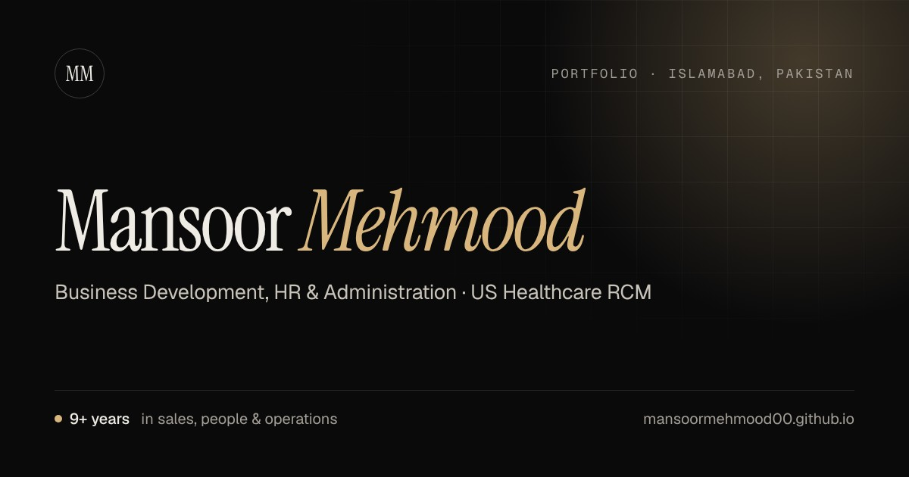

<p align="center">
  
</p>

<h1 align="center">Mansoor Mehmood</h1>

<p align="center">
  <b>Senior Manager — Business Development, HR &amp; Administration · US Healthcare RCM</b><br>
  Islamabad, Pakistan
</p>

<p align="center">
  <a href="https://mansoormehmood00.github.io"><b>View the live portfolio →</b></a>
  &nbsp;·&nbsp;
  <a href="https://www.linkedin.com/in/mansoormehmood">LinkedIn</a>
  &nbsp;·&nbsp;
  <a href="Mansoor-Mehmood-Resume.pdf">Résumé (PDF)</a>
</p>

---

## About

Business development and HR manager with **9+ years** of experience in sales, people management, administration and operations, including **4+ years in US healthcare revenue cycle management (RCM)**.

I currently lead the business development team at **Prime Medical Billing LLC**: winning new US practices for medical billing, insurance credentialing and virtual assistant services, and running recruitment, onboarding, performance appraisals and department administration.

| | |
|---|---|
| **Business Development & Sales** | B2B sales, outbound prospecting, discovery, consultative selling, proposals, pricing & contract negotiation, account management |
| **HR & Administration** | Recruitment & selection, onboarding & training, KPI setting, performance appraisals, employee relations, vendor coordination |
| **US Healthcare RCM** | Revenue cycle management, medical billing, insurance credentialing, provider relations, virtual medical assistants |
| **Leadership** | Sales floor management, sales coaching, performance management, reporting & forecasting |
| **Tools** | HubSpot CRM, BambooHR, Zoho People, Odoo HR, QuickBooks Payroll, LinkedIn Recruiter, Microsoft 365, Google Workspace |

## About this site

A hand-built, dependency-free static site hosted on GitHub Pages.

- Semantic HTML, custom CSS and vanilla JavaScript, with no frameworks and no build step
- Light and dark themes that follow the system setting and can be switched by hand
- Responsive from 320px phones to wide desktops, and honours `prefers-reduced-motion`
- Self-hosted typefaces: [Instrument Serif](https://github.com/Instrument/instrument-serif) and [Geist](https://github.com/vercel/geist-font), both under the SIL Open Font License
- SEO-ready, with Open Graph and Twitter cards, JSON-LD `Person` schema, a sitemap and `robots.txt`

```
index.html        → page markup and content
style.css         → design system and layout
main.js           → interactions (theme, reveal, tabs, accordion, counters)
favicon.svg       → monogram favicon
og-image.jpg      → social share card
Mansoor-Mehmood-Resume.pdf → downloadable résumé
```

---

<p align="center">© Mansoor Mehmood</p>
